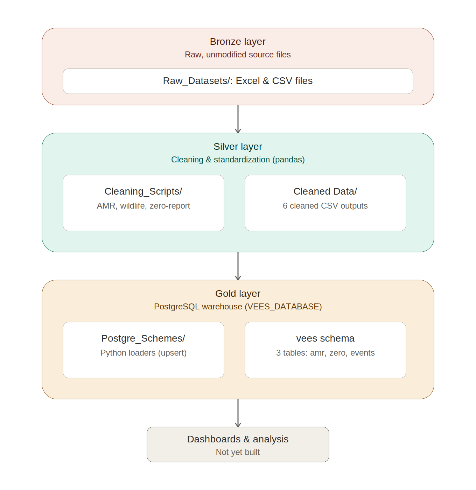

# VEES Data Cleaning and Database

Cleaning pipelines and PostgreSQL loaders for the VEES Bulletin datasets.

## Architecture



## Project Structure

- `Raw_Datasets/`: Original Excel and CSV files.
- `Cleaning_Scripts/`: Python and notebook-based cleaning workflows.
- `02cleaning_scripts/`: automated cleaning pipeline for all datasets (see below).
- `Cleaned Data/`: Generated CSV files used for analysis and database loading.
- `Postgre_Schemes/`: PostgreSQL schema and dataset-specific loaders.

## Requirements

- Python 3.13 or later
- PostgreSQL running locally
- PostgreSQL database named `VEES_DATABASE`

Create or use the project virtual environment and install the Python dependencies:

```powershell
cd "C:\Users\ADMIN\Documents\VEES_Bulletin_Hackathon"
\.venv\Scripts\python.exe -m pip install -r requirements.txt
```

`openpyxl` and `xlrd` provide support for reading `.xlsx` and `.xls` files.

## Automated Cleaning Pipeline (`02cleaning_scripts/`)

One command cleans every dataset. Run it from the project root:

```bash
.venv/bin/python 02cleaning_scripts/run_all_cleaning.py          # macOS / Linux
.venv\Scripts\python.exe 02cleaning_scripts\run_all_cleaning.py  # Windows
python 02cleaning_scripts/run_all_cleaning.py --only zero_report_cleaning clean_amr   # a subset
```

**After a new data pull:** drop the new exports into `data/kabs1.0_raw/` and `data/kabs2.0_raw/`, keeping the export naming `<form>_DDMMYYYY.csv` (e.g. `nd1_15112026.csv`, `zrf_15112026.csv`). Each script uses the newest dated file automatically. Any input can also be set by hand with the script's `--src` / `--v1` / `--v2` options.

Rules shared by every dataset:

- `clean_admin_names.py`: county, sub-county and ward names are changed to the Kenya shapefile names (`data/reference/kenya_shapefile_admin_lookup.csv`), so all cleaned data joins to the maps. Where a form has GPS but no place names, they are taken from the GPS point.
- `harmonise.py`: one spelling per disease, sign/syndrome and species; dates parsed; GPS checked against Kenya. Missing values are never turned into 0, and the text `N/A` is kept distinct from a blank.
- `build_admin_lookup.py`: rebuilds the shapefile name lookup. Only needed if the boundary files in `data/*.geojson` change.

| Step | Script | Sources | Output in `Cleaned Data/` |
| --- | --- | --- | --- |
| 1 | `00cleaning.py` | ND1 from KABS 1.0 and 2.0, plus older exports (`combined_reports.xlsx`, `live_kabs_export.csv`, `kabs_events_admin_corrected.csv`, `kabs_2020_2026.xlsx`). Events found in more than one source are counted once. | `nd1_final.csv` |
| 2 | `automated_cleaning_script.py` | `nd1_final.csv` | `nd1_final_clean.csv`, `admin_lookup.csv`, `disease_name_mapping.csv` |
| 3 | `zero_report_cleaning.py` | KABS 1.0 zero report + archive, KABS 2.0 ZRF, `Zero Report_KABS.xls`. Only the zero-reported diseases for each species count; other species–disease pairs are marked `Out of scope`. | `zero_report_combined_clean.csv`, `zero_report_combined_long.csv` |
| 4 | `clean_wildlife.py` | KABS 1.0 wildlife syndrome | `wildlife_clean.csv` |
| 5 | `clean_meat_inspection.py` | KABS 1.0 `food_safety_clean.rds`, KABS 2.0 meat inspection, Kiserian JSON | `meat_inspection_reports_clean.csv`, `meat_inspection_conditions_clean.csv`, `meat_inspection_organs_clean.csv` |
| 6 | `clean_vaccination.py` | KABS 2.0 vaccination form | `vaccination_clean.csv` |
| 7 | `clean_community_reports.py` | Community reports | `community_reports_clean.csv` |
| 8 | `clean_amr.py` | NVLS active AMR surveillance | `amr_clean.csv` |
| 9 | `clean_population.py` | Human and livestock population | `population_human_county_clean.csv`, `population_livestock_county_clean.csv`, `population_livestock_subcounty_clean.csv` |

Requirements: the packages in `requirements.txt`, plus R (`Rscript`) for step 5's KABS 1.0 `.rds` file. If one step fails, the other steps still run, and the failed steps are listed at the end. The full run takes about 40 seconds.

## Cleaning Scripts

Run these commands from the project root:

```powershell
\.venv\Scripts\python.exe Cleaning_Scripts\amr.py
\.venv\Scripts\python.exe Cleaning_Scripts\wildlife_cleaning.py
\.venv\Scripts\python.exe Cleaning_Scripts\zero_reports.py
```

Generated files:

| Dataset | Output |
| --- | --- |
| AMR surveillance | `Cleaned Data/AMR_CLEANED.csv` |
| KABS events | `Cleaned Data/Kabs_cleaned.csv` |
| LIMS disease records | `Cleaned Data/lims_cleaned.csv` |
| Vaccination records | `Cleaned Data/vaccination_cleaned.csv` |
| Wildlife events | `Cleaned Data/wildlife_cleaned_df.csv` |
| KABS zero reports | `Cleaned Data/zero_cleaned.csv` |

The AMR cleaning script removes laboratory and submission metadata. The wildlife cleaning script converts date and numeric fields and fills missing values. The zero-report cleaning script removes submitter metadata and fills missing values with `Unknown` or `0` where appropriate.

## PowerShell Commands

Run these commands from the project root. Generate the cleaned files first:

```powershell
cd "C:\Users\ADMIN\Documents\VEES_Bulletin_Hackathon"
\.venv\Scripts\python.exe Cleaning_Scripts\amr.py
\.venv\Scripts\python.exe Cleaning_Scripts\wildlife_cleaning.py
\.venv\Scripts\python.exe Cleaning_Scripts\zero_reports.py
```

Set PostgreSQL connection values for the current PowerShell session:

```powershell
$env:PGUSER = "postgres"
$env:PGPASSWORD = "your_password"
$env:PGHOST = "localhost"
$env:PGPORT = "5432"
$env:PGDATABASE = "VEES_DATABASE"
```

Install the database dependencies and run the loaders:

```powershell
\.venv\Scripts\python.exe -m pip install sqlalchemy psycopg2-binary
\.venv\Scripts\python.exe Postgre_Schemes\load_amr.py
\.venv\Scripts\python.exe Postgre_Schemes\load_zero_reports.py
\.venv\Scripts\python.exe Postgre_Schemes\load_to_postgres.py --input "Cleaned Data\Kabs_cleaned.csv"
```

## PostgreSQL Loading

The loaders default to these local connection settings when environment variables are not set:

```text
User:     postgres
Password: 1234
Host:     localhost
Port:     5432
Database: VEES_DATABASE
```

Run the AMR loader:

```powershell
\.venv\Scripts\python.exe Postgre_Schemes\load_amr.py
```

This reads `Cleaned Data/AMR_CLEANED.csv`, creates `vees.amr_clean`, and loads 1,475 AMR records using repeatable upserts.

Run the zero-report loader:

```powershell
\.venv\Scripts\python.exe Postgre_Schemes\load_zero_reports.py
```

This reads `Cleaned Data/zero_cleaned.csv`, creates `vees.zero_reports`, and loads the zero-report records using repeatable upserts.

The general events loader is also available:

```powershell
\.venv\Scripts\python.exe Postgre_Schemes\load_to_postgres.py
```

It loads `Cleaned Data/Kabs_cleaned.csv` into `vees.events_clean` using `Postgre_Schemes/schema.sql`.

The same variables are used by all three loaders. Each loader creates its destination table if it does not exist and uses an upsert so it can be run again safely.

## SQL Setup and Verification

Create the database once from a PostgreSQL client such as `psql`:

```sql
CREATE DATABASE "VEES_DATABASE";
```

Connect to `VEES_DATABASE` and apply the shared events schema:

```powershell
psql -U postgres -h localhost -d VEES_DATABASE -f Postgre_Schemes\schema.sql
```

The dataset loaders also create their required tables automatically. The current database tables are:

| Dataset | PostgreSQL table |
| --- | --- |
| KABS events | `vees.events_clean` |
| AMR surveillance | `vees.amr_clean` |
| KABS zero reports | `vees.zero_reports` |

Verify row counts and inspect sample records with SQL:

```sql
SELECT COUNT(*) FROM vees.amr_clean;
SELECT COUNT(*) FROM vees.zero_reports;
SELECT COUNT(*) FROM vees.events_clean;

SELECT * FROM vees.amr_clean LIMIT 5;
SELECT * FROM vees.zero_reports LIMIT 5;
SELECT * FROM vees.events_clean LIMIT 5;
```

The cleaned LIMS, vaccination, and wildlife CSV files are available in `Cleaned Data/`. Dedicated PostgreSQL loaders for those datasets have not yet been added.
